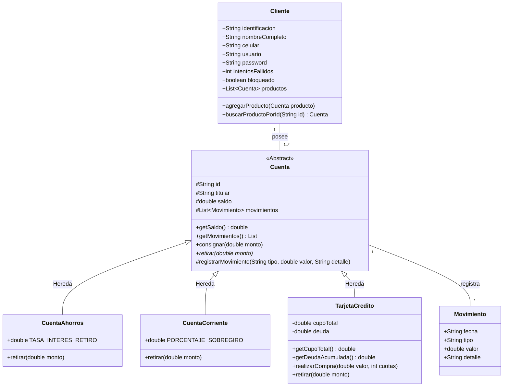

# 🏦 Documentación Oficial del Proyecto: Mi Plata (Simulador Bancario)

## 📋 Información General
- **Proyecto:** Mi Plata - Sistema de Gestión Bancaria Académica
- **Nivel:** Técnica Laboral en Desarrollo de Software (3.er Semestre)
- **Repositorio:** [GitHub - Mi Plata](https://github.com/tu-usuario/mi-plata)

---

## 🎨 1. Maquetación / Wireframe Responsivo
El diseño de la interfaz sigue un enfoque adaptativo (*Responsive Web Design*) estructurado para las resoluciones estándar solicitadas:
- **Desktop / Laptop:** 1920px
- **Tablet:** 786px
- **Smartphone:** 460px

### 🖼️ Maqueta HTML/CSS Interactiva de Demostración
```html
<!DOCTYPE html>
<html lang="es">
<head>
    <meta charset="UTF-8">
    <meta name="viewport" content="width=device-width, initial-scale=1.0">
    <title>Wireframe - Mi Plata</title>
    <style>
        * { box-sizing: border-box; margin: 0; padding: 0; font-family: sans-serif; }
        body { background-color: #f4f6f9; color: #333; padding: 10px; }
        .wf-container { max-width: 1920px; margin: 0 auto; border: 2px dashed #0f2b46; padding: 15px; background: #fff; }
        .wf-header { background: #0f2b46; color: white; padding: 15px; display: flex; justify-content: space-between; align-items: center; border-radius: 4px; }
        .wf-hero { background: #e0e7ff; border: 1px solid #c7d2fe; padding: 20px; margin: 15px 0; border-radius: 4px; text-align: center; }
        .wf-grid { display: grid; grid-template-columns: repeat(3, 1fr); gap: 15px; }
        .wf-card { border: 1px solid #ccc; padding: 15px; border-radius: 4px; background: #fafafa; text-align: center; }
        
        /* Tablet: 786px */
        @media (max-width: 786px) {
            .wf-container { max-width: 786px; }
            .wf-grid { grid-template-columns: repeat(2, 1fr); }
        }
        
        /* Smartphone: 460px */
        @media (max-width: 460px) {
            .wf-container { max-width: 460px; }
            .wf-header { flex-direction: column; gap: 10px; text-align: center; }
            .wf-grid { grid-template-columns: 1fr; }
        }
    </style>
</head>
<body>
    <div class="wf-container">
        <header class="wf-header">
            <div><strong>[LOGO] Mi Plata</strong></div>
            <div>[NAVEGACIÓN: Inicio | Login | Registro]</div>
        </header>
        <section class="wf-hero">
            <h2>[HERO VDO 1920x180] Bienvenido a Mi Plata</h2>
            <p>Simulador de productos financieros</p>
        </section>
        <section class="wf-grid">
            <div class="wf-card"><strong>[IMAGE 1]</strong><br>Cuenta de Ahorros</div>
            <div class="wf-card"><strong>[IMAGE 2]</strong><br>Cuenta Corriente</div>
            <div class="wf-card"><strong>[IMAGE 3]</strong><br>Tarjeta de Crédito</div>
        </section>
    </div>
</body>
</html>
```

---

## 📊 2. Diagrama UML de Clases

A continuación se representa la arquitectura POO del sistema en formato Mermaid.



---

## 👥 3. Roles del Equipo de Desarrollo

| Rol | Integrante | Responsabilidades Principales |
| :--- | :--- | :--- |
| **Scrum Master / Lead Dev** | Mateo Quiñones | Coordinación general del proyecto, integración de repositorio GitHub y validación de entregables. |
| **Frontend Developer** | Integrante 2 | Maquetación HTML5, estilos CSS3 responsivos para Desktop/Tablet/Mobile y ventanas modales. |
| **Backend / POO Developer** | Integrante 3 | Modelado de clases POO en JavaScript (`Cuenta`, `Ahorros`, `Corriente`, `TarjetaCredito`), manejo de sobregiros e intereses. |
| **QA / Tester** | Integrante 4 | Elaboración de historias de usuario, validación de reglas de negocio, seguridad (bloqueo por 3 intentos) y almacenamiento local. |

---

## 📝 4. Historias de Usuario (User Stories)

### HU-01: Registro e Inicio de Sesión Seguro
- **Como:** Cliente del banco.
- **Quiero:** Registrar mis datos e iniciar sesión con usuario y contraseña.
- **Para:** Acceder a mis productos financieros de forma segura.
- **Criterios de Aceptación:**
  - El usuario debe ser único en el sistema.
  - Al fallar la contraseña 3 veces consecutivas, la cuenta debe quedar bloqueada.

### HU-02: Consignaciones y Retiros con Reglas de Negocio
- **Como:** Titular de una cuenta.
- **Quiero:** Consignar dinero y retirar de mis cuentas de ahorros o corriente.
- **Para:** Administrar mis fondos según mis necesidades.
- **Criterios de Aceptación:**
  - En **Cuenta de Ahorros**, el retiro aplica un 1.5% de interés.
  - En **Cuenta Corriente**, se permite un sobregiro de hasta el 20% del saldo actual.

### HU-03: Transferencias entre Cuentas
- **Como:** Cliente bancario.
- **Quiero:** Transferir dinero a otros productos propios o de terceros.
- **Para:** Enviar dinero sin necesidad de ir a una sucursal física.
- **Criterios de Aceptación:**
  - Debe permitir seleccionar fácilmente el ID del producto destino.
  - No se permiten transferencias desde o hacia tarjetas de crédito.

### HU-04: Compras con Tarjeta de Crédito
- **Como:** Tarjetahabiente.
- **Quiero:** Realizar diferidos de compras entre 1 y 36 cuotas.
- **Para:** Financiar mis compras con cálculo de intereses.
- **Criterios de Aceptación:**
  - De 1 a 2 cuotas: 0% de interés.
  - De 3 a 6 cuotas: 1.9% mensual.
  - De 7 o más cuotas: 2.3% mensual.